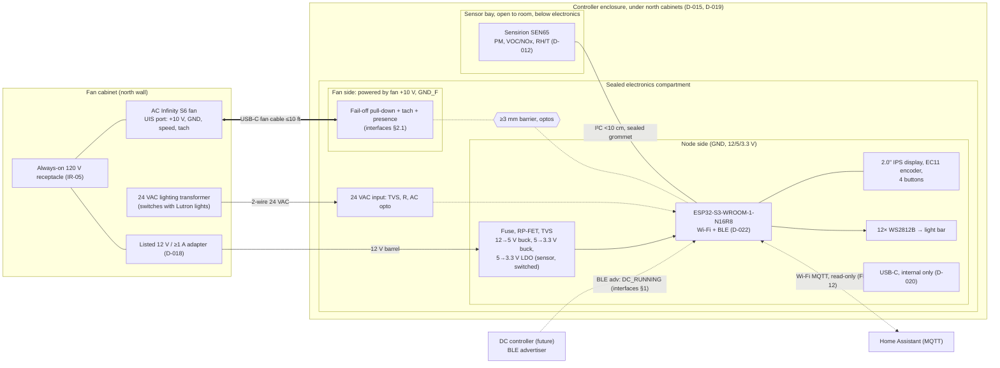

# Architecture

**Status:** drafted for G2 (2026-10-25, nightly). Approved requirements: `docs/requirements.md`. Detail lives in `docs/interfaces.md` (signals, pins, power, HA entities, mechanical interfaces) and `docs/control-logic.md` (state machine). New decisions: D-017…D-023.

**Not a life-safety device.** Air-quality sensing here is a convenience control. It is not respiratory protection and doesn't on its own protect health (SR-05).

## 1. Block diagram



## 2. Partitioning

| Concern | Where it lives | Why |
|---------|----------------|-----|
| Mains | Nowhere in our design. The fan and a listed adapter plug into the existing always-on receptacle | 0 % PWM is a true off (Q-15), so there's nothing to switch (D-013). SR-01a isn't triggered; G3 covers only the receptacle and adapter (SR-07) |
| Fan speed and off | Fan's UIS port, through an isolated, fan-powered fail-off interface | SR-08 (off when the node is dead), SR-09 (isolation), FR-10 |
| Control logic | `exhaust_logic`, pure C++ on the node | NFR-01, NFR-06; host-tested |
| Sensing | One SEN65 in a bay open to the room | D-012, NFR-04, NFR-09 |
| User interface | Panel on the enclosure front | D-003, D-009, FR-01, FR-11 |
| DC link | BLE advertising, scanned by the on-module radio | D-016, IR-01/02 |
| History and alerts | HA over MQTT, read-only | FR-12, FR-13, FR-16 dropped |

## 3. Electronics (one 2-layer PCB, D-008)

- **MCU:** ESP32-S3-WROOM-1-N16R8 (D-022). PSRAM holds LVGL buffers and leaves internal RAM for NimBLE plus Wi-Fi/MQTT/TLS OTA (the D-016 RAM concern). The PCB antenna sits at the board's top edge, with a keep-out and no copper or enclosure metal around it.
- **Fan interface:** `docs/interfaces.md` §2.1. Three optos cross the barrier (speed, tach, presence). The fan side is powered by the fan's +10 V, so the default (unlit LED) state is fan off.
- **Occupancy:** AC-input opto from 24 VAC (`docs/interfaces.md` §2.2).
- **Power:** 12 V in, two bucks and a switched sensor LDO (`docs/interfaces.md` §3). Peak ≈ 4.8 W, typical ≈ 1.3 W.
- **Panel:** display module on a header; encoder and tact switches mounted on the PCB front, behind the bezel. Board-edge LEDs feed the light bar.
- **PCBA (NFR-05):** SMT on one side from JLC basic/preferred parts where possible. Through-hole (barrel jack, terminal block, display header, encoder) is hand-soldered or done as a THT add-on. The tier rules are checked in the phase 3 vendor research.
- **Off-board wiring:** fan cable (USB-C, Q-25 pin map), 2-conductor thermostat wire to the 24 VAC terminals, 12 V barrel. WireViz drawing in `electrical/` in phase 3 (D-010).

## 4. Firmware (ESP-IDF, C++)

```
firmware/
  main/                       app wiring, task creation
  components/
    esp-iot-core/             submodule (D-007): Wi-Fi, OTA, remote log, BaseMqttClient, NetworkTaskManager
    exhaust_logic/            pure C++20: Controller, Sampler, AutoDemand, ModeManager, OutputShaper,
                              Faults, Maintenance, UiInput, DcLinkParser, Config.h (P-nn, C-nn, button map)
    gas_index/                Sensirion gas index algorithm (BSD-3, vendored C), D-017
    hass/                     HassMessages (pure) + MqttExhaustHomeClient (BaseMqttClient)
    drivers/                  Sen6x (I²C), FanPort (LEDC 5 kHz + tach ISR + present), Occupancy,
                              Panel (PCNT encoder, buttons), Display (esp_lcd ST7789 + LVGL), Indicator (RMT)
    dc_link/                  NimBLE passive scanner → DcLinkParser
  test/                       host GoogleTest (control-logic.md §10), results committed
```

| Task | Rate | Owns |
|------|------|------|
| `control` | 1 Hz tick + event queue | `Controller`; writes the fan duty; publishes a snapshot (mutex) for UI/indicator/HA |
| `sensor` | 1 Hz while measuring | SEN65 I²C; carries out Measure/Idle/PowerCycle/Clean; posts frames |
| `ui` | 10–20 Hz | LVGL; reads the snapshot; panel events → `UiInput` → `control` queue |
| `ble` | continuous scan | NimBLE observer; `DcLinkParser`; posts `dc_running` and RSSI |
| network | esp-iot-core | Wi-Fi, MQTT, OTA, remote logging; HA state from the snapshot |

- The task watchdog covers `control` and `sensor`. On any reset the opto LED goes dark, so the fan is off in hardware until `control` decides (SR-08, NFR-07).
- Nothing in `control` waits on the network (NFR-01). MQTT publishing reads a copy of the snapshot.
- BLE/Wi-Fi coexistence: the ESP-IDF software coexistence is on; the 30 % scan duty is tested alongside OTA (AC-22).
- `P-nn`/`C-nn` and the button map live in one `Config.h`. Changes go by OTA (NFR-10 dropped, NFR-11).

## 5. Mechanical concept (D-019, details in phase 3)

- One printed enclosure (MJF PA12, D-011) with two compartments: a **sealed electronics compartment** on top (gasketed lid, no vents, sealed encoder shaft and membrane-covered buttons; IP5X intent, NFR-04), and an **open sensor bay** below it with a front grille, its inlet facing south into the room (NFR-09).
- Bay below the electronics, with an insulating air gap in the dividing wall: it keeps the SEN65 below and away from the ~1.3 W of electronics heat, as Sensirion recommends, and the RH/T offset is tuned at commissioning (FR-20).
- Tool-less bay cover. The module unplugs at its own end, and its cable crosses into the electronics compartment through a sealed grommet (NFR-03, NFR-04).
- Front face toward the room: display, encoder and buttons up top, the light bar along the bottom edge.
- The enclosure hangs from a cabinet bracket and comes off with one screw (`docs/interfaces.md` §5). Dimensions wait on Q-27.
- No part of the controller is in the exhaust airstream (SR-02): it's outside the cabinet, ≥ 3 ft from the hood.

## 6. Failure modes

| Failure | Effect | Handling | Req / AC |
|---------|--------|----------|----------|
| Node unpowered, crashed, resetting, booting | No control | Fan held **off** by the fan-powered pull-down; HA shows offline via LWT | SR-08, FR-13, AC-18, AC-09 |
| Fan cable unplugged | Fan runs **full** (fan behavior) | `fan_port` fault from loss of `FAN_PRESENT` (displayed; HA) | SR-08, FR-18 |
| Fan has no mains / motor failed | No exhaust | `fan_port` (no +10 V) or `fan_tach` fault | FR-18, AC-07 |
| SEN65 fault (no data, status, range) | No PM/VOC | SR-04 fallback (occupied ≥ P-19, vacant off); power-cycle retries; Spray uses P-09 alone | SR-04, AC-20 |
| SEN65 fouled (reads high) | Fan runs too long | FR-19 vacant caps (P-22, P-21) and the clear-down incomplete notice | FR-19, AC-27 |
| Wi-Fi, broker or HA down | No history or alerts | No control impact | NFR-01, AC-12 |
| DC link lost or DC absent | No boost | Treated as DC off after P-24; boost persists P-11 | IR-01, AC-22 |
| Spoofed BLE frame | False boost only | Accepted risk; allow-list option | `interfaces.md` §1 |
| 24 VAC input lost | Reads vacant | Trusted signal, no handling (Q-17); display shows Vacant | FR-07 |
| Fan-port mains fault (port not SELV) | Hazard on fan-side circuits | ≥ 3 mm barrier, rated optos; nothing fan-side is touchable; flashing USB is on the node side | SR-09, AC-26 |
| Fan cable plugged into the flashing USB port | Fan +10 V on node USB pins; isolation bypassed | Flashing port is internal only (D-020) | SR-09 |
| Adapter fault | Node dead → fan off | Listed adapter, input fuse, TVS | SR-01, SR-08 |

## 7. Traceability (M and S requirements)

| Req | Design element | Verified by |
|-----|----------------|-------------|
| FR-01 | `UiInput`, button map in `Config.h`, encoder flow (control-logic §8) | AC-08 |
| FR-02 | `AutoDemand` §4, `OutputShaper` §7 | AC-01 |
| FR-04, FR-06 | `Sampler` §5 | AC-02 |
| FR-05 | `Sampler` rest rule and decay fit §5; `decay_rate`/`airflow_est` entities | AC-03 |
| FR-07 | Occupancy input §2.2; control-logic §3; Sampler Off | AC-04 |
| FR-08, SR-03 | Spray/SprayRunOn §2; Protect state §5 | AC-05 |
| FR-09 | `DcBoostActive` §4; BLE link §1 | AC-06, AC-22 |
| FR-10 | Fan interface §2.1; LEDC 5 kHz; C-06 | AC-07, AC-18 |
| FR-11 | Display model §8 | AC-08 |
| FR-12, FR-13, IR-03 | HA entities (interfaces §4); `HassMessages` | AC-09 |
| FR-14 | Host-side gas index, paused across Idle (D-017); VocValid gating | AC-10, AC-28 |
| FR-15 | Indicator §8; light bar (§5) | AC-11 |
| FR-18 | Tach and presence optos; `fan_tach`/`fan_port` faults | AC-07 |
| FR-19 | Vacant cap/limit §4; SprayRunOn vacant exit §2 | AC-27 |
| NFR-01 | No network dependence in `control` (§4) | AC-12 |
| NFR-02 | Sampler duty; weekly clean; sensor-hours entity | AC-13 |
| NFR-03, NFR-04 | Sensor bay, tool-less cover, sealed compartment (§5) | AC-14, AC-15 |
| NFR-05 | One-sided SMT, JLC parts (§3) | AC-24 |
| NFR-06 | `exhaust_logic` + host tests | AC-16 |
| NFR-07, SR-08 | Fan-powered fail-off; boot to Auto | AC-18 |
| NFR-08 | Cost estimate (§8) | AC-24 |
| NFR-09 | Location, inlet orientation (interfaces §5) | AC-17 |
| NFR-11 | esp-iot-core OTA; internal USB | AC-19 |
| SR-01, SR-01a, SR-07 | No mains in the design; listed adapter (D-018) | AC-21 |
| SR-02 | Enclosure outside the cabinet and airstream | AC-15 |
| SR-04 | Fault table and fallback (control-logic §6, §4) | AC-20 |
| SR-05, SR-06 | Statements here, in the README and on the panel's About page | AC-25 |
| SR-09 | Barrier, optos, internal USB (D-020) | AC-26 |
| IR-01, IR-02 | BLE payload v1.0 (interfaces §1.1) | AC-22 |
| IR-04, IR-05 | Three short LV cables; always-on receptacle | AC-23 |

Design elements without a requirement: the `fan_port` presence detect (an extension of FR-18 for the "cable unplugged → full speed" case) and the Auto long-press abort (control-logic §2). Both are flagged for G2.

## 8. Cost estimate (NFR-08, AC-24)

These are **estimates from memory, not checked against distributors** (except the SEN66 reference price, DigiKey 2026-10-25). G4 replaces them with quoted prices.

| Item | Est. USD |
|------|---------:|
| SEN65 (SEN66 is $62; SEN65 assumed lower) | 45 |
| On-board parts per board: ESP32-S3 module 5, display module 8, encoder + knob 4, switches 2, LEDs + shifter 2, optos 3, power 5, connectors 2, passives/ESD 3 | 34 |
| Second assembled board (JLC PCBA minimum quantity is 2; a spare) | 34 |
| PCB fab + PCBA fees (setup, stencil, extended-part fees) | 35 |
| Enclosure, MJF PA12, two parts + bracket | 40 |
| Gasket, heat-set inserts, screws, diffuser | 10 |
| 12 V listed adapter + barrel extension | 15 |
| Fan cable (USB-C, 3 m) and 10 ft of 18/2 thermostat wire | 17 |
| Shipping and duties (PCBA and print in one JLC order) | 35 |
| **Total** | **≈ 265** (range ≈ 225–300) |

Under the $300 ceiling, but not "well below" it. Most of it is fixed overhead (PCBA fees, the second board, shipping and duties) and the sensor. The levers, in order: one JLC order for PCBA and print (shipping); minimize extended parts (fees); a smaller enclosure, or FDM instead of MJF; a cheaper display module. Tariffs and shipping are the main uncertainty.

## 9. To verify in phase 3 (not blocking G2)

- SEN6x datasheet: raw VOC command and its scaling (D-017), algorithm-state backup/restore as the fallback, device-status bits, manual fan-clean command, connector part and pinout.
- H11L1-class opto: inverting output polarity, VCC 5 V supply current, propagation delay; a JLC-stocked part with VDE 0884 / IEC 60747-5-5.
- Fan-side LDO input rating (≥ 16 V) and quiescent current.
- ESP32-S3 GPIO reset states and boot glitches on the GPIOs chosen for `FAN_PWM` and `SEN_PWR_EN`.
- Display module choice (header pinout, backlight drive) and mechanical outline.
- JLC Economic PCBA rules (STATE action), opto/creepage footprints, and the antenna keep-out on the module footprint.
- USB-C pin mapping of the fan cable (Q-25) before the fan connector footprint is wired.
